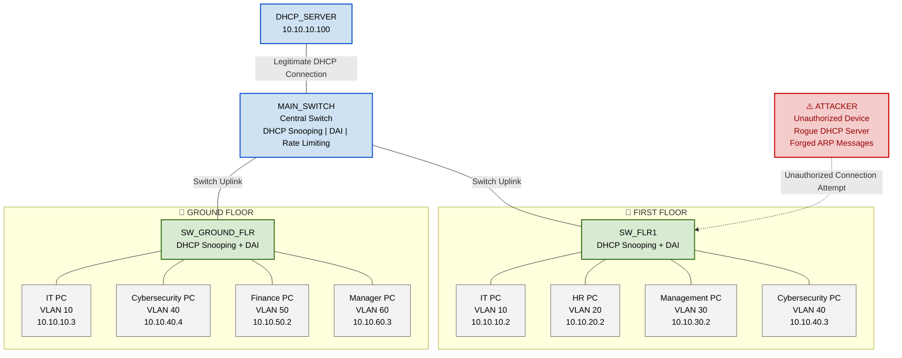

# 🔐 Campus Secure Network

### Enterprise VLAN Segmentation • Centralized DHCP • Secure Network Infrastructure

> **Enterprise Network Simulation | EVE-NG | IPv4 | VLANs | 802.1Q | DHCP | Network Security**

<div align="center">

**3 Switches** • **1 DHCP Server** • **8 Endpoints** • **6 VLANs** • **6 Departmental Networks**

</div>

---

## 🎯 1. Project Objective

Design and implement a simulated enterprise campus network representing a small company's office environment with multiple floors and departments using EVE-NG and Cisco IOS. The project focuses on VLAN-based network segmentation, access and trunk port configuration, inter-VLAN routing, centralized DHCP services, and DHCP relay to enable dynamic IP address allocation across multiple subnets. It also incorporates DHCP Snooping to protect against unauthorized DHCP servers, SSH-only remote management to secure administrative access, and network connectivity verification using Cisco IOS diagnostic commands. The overall objective is to build a structured, reliable, and secure campus network while gaining practical experience in enterprise networking, network troubleshooting, and network security.


# 🖥️ 2. Network Topology

## 🏢 Campus Network Architecture

The network is organized into three main switching components:

1. **MAIN_SWITCH** — Central switching device.
2. **SW_FLR1** — First-floor departmental switch.
3. **SW_GROUND_FLR** — Ground-floor departmental switch.

The floor switches connect departmental endpoints to the network. Trunk links transport the required VLANs between switches.

The DHCP server connects to the central switching infrastructure to provide DHCP services.

### 📸 EVE-NG Topology


---

# 🖧 3. Device Inventory

## 🔹 Switching Infrastructure

| No. | Device Name | Role | Primary Responsibility |
|---:|---|---|---|
| 1 | `MAIN_SWITCH` | Central switch | VLAN interfaces, central switching, DHCP relay |
| 2 | `SW_FLR1` | First-floor switch | Departmental endpoint connectivity |
| 3 | `SW_GROUND_FLR` | Ground-floor switch | Departmental endpoint connectivity |

## 🔹 Server Infrastructure

| No. | Device Name | Role | IP Address |
|---:|---|---|---|
| 1 | `DHCP_SERVER` | Central DHCP server | `10.10.10.100` |

## 🔹 End Devices

| No. | Device Name | Department | VLAN |
|---:|---|---|---:|
| 1 | `VPC1_VLAN10_IT` | IT | 10 |
| 2 | `VPC2_VLAN20_HR` | HR | 20 |
| 3 | `VPC3_VLAN30_MGMT` | Management | 30 |
| 4 | `VPC2_cyber_VLAN40` | Cybersecurity | 40 |
| 5 | `VPC4_VLAN40_Cyber` | Cybersecurity | 40 |
| 6 | `VPC5_VLAN50_FINANCE` | Finance | 50 |
| 7 | `VPC2_IT_VLAN10` | IT | 10 |
| 8 | `VPC6_VLAN60_MANAGER` | Manager | 60 |

---

# 🔢 4. IP Addressing Plan

## 💻 4.1 End-Device IP Addressing

| Device Name | VLAN | IP Address | Subnet Mask | Default Gateway |
|---|---:|---|---|---|
| `VPC1_VLAN10_IT` | 10 | `10.10.10.2` | `255.255.255.0` | `10.10.10.1` |
| `VPC2_VLAN20_HR` | 20 | `10.10.20.2` | `255.255.255.0` | `10.10.20.1` |
| `VPC3_VLAN30_MGMT` | 30 | `10.10.30.2` | `255.255.255.0` | `10.10.30.1` |
| `VPC2_cyber_VLAN40` | 40 | `10.10.40.3` | `255.255.255.0` | `10.10.40.1` |
| `VPC4_VLAN40_Cyber` | 40 | `10.10.40.4` | `255.255.255.0` | `10.10.40.1` |
| `VPC5_VLAN50_FINANCE` | 50 | `10.10.50.2` | `255.255.255.0` | `10.10.50.1` |
| `VPC2_IT_VLAN10` | 10 | `10.10.10.3` | `255.255.255.0` | `10.10.10.1` |
| `VPC6_VLAN60_MANAGER` | 60 | `10.10.60.3` | `255.255.255.0` | `10.10.60.1` |

## 📡 4.2 DHCP Server Addressing

| Parameter | Configuration |
|---|---|
| Device Name | `DHCP_SERVER` |
| Server IP Address | `10.10.10.100` |
| Connected Network | VLAN 10 / IT |
| DHCP Relay Device | `MAIN_SWITCH` |
| Helper Address | `10.10.10.100` |


---

# 🔌 5. Interface Mapping


## 🔹 5.1 MAIN_SWITCH

| Local Interface | Connected Device | Remote Interface | Purpose |
|---|---|---|---|
| `Gi0/0` | `DHCP_SERVER` | `Gi0/0` | DHCP server connectivity |
| `Gi0/1` | `SW_FLR1` | Verify in EVE-NG | First-floor uplink |
| `Gi1/1` | `SW_GROUND_FLR` | Verify in EVE-NG | Ground-floor uplink |

## 🔹 5.2 SW_FLR1

| Local Interface | Connected Device | Purpose |
|---|---|---|
| `Gi0/1` | `VPC1_VLAN10_IT` | IT endpoint |
| `Gi0/2` | `VPC2_VLAN20_HR` | HR endpoint |
| `Gi0/3` | `VPC3_VLAN30_MGMT` | Management endpoint |
| `Gi1/0` | `VPC2_cyber_VLAN40` | Cybersecurity endpoint |
| Uplink | `MAIN_SWITCH` | Trunk link; verify interface |

## 🔹 5.3 SW_GROUND_FLR

| Local Interface | Connected Device | Purpose |
|---|---|---|
| `Gi0/0` | `VPC2_IT_VLAN10` | IT endpoint |
| `Gi0/1` | `VPC4_VLAN40_Cyber` | Cybersecurity endpoint |
| `Gi0/2` | `VPC5_VLAN50_FINANCE` | Finance endpoint |
| `Gi0/3` | `VPC6_VLAN60_MANAGER` | Manager endpoint |
| Uplink | `MAIN_SWITCH` | Trunk link; verify interface |

### 🔍 Interface Verification Commands

```cisco
show ip interface brief
show interfaces status
show interfaces trunk
show cdp neighbors
show running-config
```

---

# 🛠️ 6. Technologies Used

| Technology | Purpose |
|---|---|
| EVE-NG | Network emulation |
| Cisco IOS | Device configuration and troubleshooting |
| IPv4 | Network-layer addressing |
| VLANs | Departmental segmentation |
| IEEE 802.1Q | VLAN tagging across trunk links |
| Access Ports | Endpoint connectivity |
| Trunk Ports | Multi-VLAN connectivity between switches |
| VLAN Interfaces | VLAN gateway configuration |
| DHCP | Dynamic address allocation |
| DHCP Relay | DHCP forwarding across subnets |
| DHCP Snooping | DHCP server protection |
| SSH Version 2 | Encrypted remote management |
| NTP | Network time synchronization |
| Wireshark | Packet capture and protocol analysis |
| Cisco IOS CLI | Configuration and verification |

---

# 🛠️ 7. Tasks to Perform

---
# 🔹 Phase 1 — Interface Configuration, VLANs and Switching

## 🎯 Objective

Configure all required VLANs, assign VLAN names, configure access and trunk ports, and implement DHCP relay on the central switch. This phase focuses on establishing departmental network segmentation and connectivity between switches. The implementation is divided into three tasks corresponding to the switches in the topology.

---

## 📍 1.1 SW_FLR1 — First-Floor Switch Configuration

### 🎯 Objective

Configure the first-floor switch to provide network connectivity to IT, HR, Management, and Cybersecurity endpoints using VLAN segmentation, access ports, and trunk connectivity toward `MAIN_SWITCH`.

### ⚙️ Tasks to Perform

1. Create VLANs 10, 20, 30, 40, 50, and 60.
2. Assign the correct VLAN names.
3. Configure access interfaces for connected endpoints.
4. Configure the uplink toward `MAIN_SWITCH` as a trunk.
5. Allow VLANs 10, 20, 30, 40, 50, and 60 on the trunk.
6. Configure DHCP Snooping where supported.
7. Configure trusted interfaces appropriately.
8. Verify VLAN membership, interface status, and trunk operation.

### 🗂️ VLAN Configuration Plan

| VLAN ID | VLAN Name |
|---:|---|
| 10 | IT |
| 20 | HR |
| 30 | MGMT |
| 40 | CYBER |
| 50 | FINANCE |
| 60 | MANAGER |

### 🔌 Interface Configuration Plan

| Interface | Connected Endpoint | VLAN / Mode |
|---|---|---|
| `Gi0/1` | `VPC1_VLAN10_IT` | VLAN 10 — Access |
| `Gi0/2` | `VPC2_VLAN20_HR` | VLAN 20 — Access |
| `Gi0/3` | `VPC3_VLAN30_MGMT` | VLAN 30 — Access |
| `Gi1/0` | `VPC2_cyber_VLAN40` | VLAN 40 — Access |
| Uplink | `MAIN_SWITCH` | Trunk — Multiple VLANs |

### 📸 Interface Configuration


<br>

### 🔗 Trunk Port Configuration


<br>

### 🔍 Verification

```cisco
show vlan brief
show interfaces trunk
```


### 📸 VLAN and Trunk Verification


<br>


---


## 📍 1.2 SW_GROUND_FLR — Ground-Floor Switch Configuration

### 🎯 Objective

Configure the ground-floor switch to provide network connectivity to IT, Cybersecurity, Finance, and Manager endpoints.

### ⚙️ Tasks to Perform

1. Create the six departmental VLANs.
2. Configure the correct VLAN names.
3. Assign access ports to their intended VLANs.
4. Configure the uplink toward `MAIN_SWITCH` as a trunk.
5. Allow the required VLANs across the trunk.
6. Configure DHCP Snooping where supported.
7. Verify interface status and VLAN assignments.
8. Test connectivity between endpoints and their gateways.

### 🔌 Interface Configuration Plan

| Interface | Connected Endpoint | VLAN |
|---|---|---:|
| `Gi0/0` | `VPC2_IT_VLAN10` | 10 |
| `Gi0/1` | `VPC4_VLAN40_Cyber` | 40 |
| `Gi0/2` | `VPC5_VLAN50_FINANCE` | 50 |
| `Gi0/3` | `VPC6_VLAN60_MANAGER` | 60 |
| Uplink | `MAIN_SWITCH` | Trunk |

### 📸 Interface Configuration


<br>

### 🔗 Trunk Port Configuration


<br>


### 🔍 Verification

```cisco
show vlan brief
show interfaces trunk
```
<br>


<br>


---

## 📍 1.3 MAIN_SWITCH — Central Switch Configuration

### 🎯 Objective

Configure the central switching device to provide VLAN gateway interfaces, inter-VLAN routing where supported, trunk connectivity, and DHCP relay.

### ⚙️ Tasks to Perform

1. Create VLANs 10, 20, 30, 40, 50, and 60.
2. Configure the departmental VLAN names.
3. Configure trunk links to `SW_FLR1` and `SW_GROUND_FLR`.
4. Allow the required VLANs on the trunk links.
5. Configure VLAN interfaces using the planned gateway addresses.
6. Configure DHCP relay on the relevant client VLAN interfaces.
7. Configure DHCP Snooping and appropriate trusted interfaces.
8. Verify the VLAN interfaces and trunk links.
9. Test DHCP allocation and endpoint connectivity.

### 🌐 VLAN Interface Addressing

| VLAN Interface | VLAN Name | IP Address |
|---|---|---|
| `Vlan10` | IT | `10.10.10.1/24` |
| `Vlan20` | HR | `10.10.20.1/24` |
| `Vlan30` | MGMT | `10.10.30.1/24` |
| `Vlan40` | CYBER | `10.10.40.1/24` |
| `Vlan50` | FINANCE | `10.10.50.1/24` |
| `Vlan60` | MANAGER | `10.10.60.1/24` |

### 📡 DHCP Relay Configuration

The centralized DHCP server is configured with the address:

`10.10.10.100`

Example relay configuration:

```cisco
interface Vlan20
 ip helper-address 10.10.10.100
```

Apply the helper address to each relevant client VLAN interface that requires DHCP relay.

A helper address is not necessarily required on VLAN 10 because the DHCP server is directly connected to the same subnet in this design.

### 📸 Interface Configuration


<br>

<br>


### 🔗 Trunk Port Configuration

<br>


<br>


<br>
### 🔍 Verification

```cisco
show vlan brief
show interfaces trunk
```


---


# 🔹 Phase 2 — Centralized DHCP Configuration Using Router-on-a-Stick

## 🎯 Objective

Configure a centralized DHCP server using the Router-on-a-Stick architecture to provide dynamic IP address allocation to multiple departmental VLANs. Configure IEEE 802.1Q subinterfaces for VLANs 10, 20, 30, 40, 50, and 60 on the `DHCP` router, create DHCP pools for each subnet, and assign the appropriate default gateway to each pool. Finally, verify DHCP address allocation and test connectivity between endpoints within the same VLAN and across different VLANs.

---

## 📍 2.1 DHCP Router — Physical Interface and Subinterface Configuration

### 🎯 Objective

Configure the physical interface `GigabitEthernet0/0` as the trunk-connected interface and create six logical subinterfaces to support the departmental VLANs.

### ⚙️ Tasks to Perform

1. Configure the hostname as `DHCP`.
2. Enable the physical interface `GigabitEthernet0/0`.
3. Create subinterfaces for VLANs 10, 20, 30, 40, 50, and 60.
4. Configure IEEE 802.1Q encapsulation on each subinterface.
5. Assign the appropriate IP address to each subinterface.
6. Verify the interface and subinterface status.

### 🔌 Interface Configuration Plan

| Physical Interface | Subinterface | VLAN ID | Subinterface IP Address | Subnet Mask |
|---|---|---:|---|---|
| `Gi0/0` | `Gi0/0.10` | 10 | `10.10.10.100` | `255.255.255.0` |
| `Gi0/0` | `Gi0/0.20` | 20 | `10.10.20.100` | `255.255.255.0` |
| `Gi0/0` | `Gi0/0.30` | 30 | `10.10.30.100` | `255.255.255.0` |
| `Gi0/0` | `Gi0/0.40` | 40 | `10.10.40.100` | `255.255.255.0` |
| `Gi0/0` | `Gi0/0.50` | 50 | `10.10.50.100` | `255.255.255.0` |
| `Gi0/0` | `Gi0/0.60` | 60 | `10.10.60.100` | `255.255.255.0` |

### 🔗 Router-on-a-Stick — Explanation

**Router-on-a-Stick** is a network architecture in which one physical router interface uses multiple logical subinterfaces to route traffic between VLANs.

In this project, `GigabitEthernet0/0` connects the DHCP router to the switching infrastructure. Each subinterface is associated with a VLAN using IEEE 802.1Q encapsulation.

#### 🔄 How It Works

1. **Physical Interface:** `GigabitEthernet0/0` connects the router to the switch.
2. **Subinterfaces:** Separate logical interfaces are created for VLANs 10, 20, 30, 40, 50, and 60.
3. **VLAN Tagging:** IEEE 802.1Q identifies the VLAN associated with each tagged Ethernet frame.
4. **Gateway Addresses:** Each subinterface receives an IP address from its corresponding VLAN subnet.
5. **Inter-VLAN Routing:** The router routes traffic between VLANs when routing and interface configurations are operational.

#### 📋 Router-on-a-Stick Details

| Parameter | Description |
|---|---|
| Router Name | `DHCP` |
| Physical Interface | `GigabitEthernet0/0` |
| Architecture | Router-on-a-Stick |
| Encapsulation | IEEE 802.1Q |
| Subinterfaces | 6 |
| Supported VLANs | 10, 20, 30, 40, 50, 60 |
| Purpose | VLAN gateway connectivity and inter-VLAN routing |


## 📍 2.2 DHCP Router — DHCP Pool Configuration

### 🎯 Objective

Configure six DHCP pools on the `DHCP` router to dynamically assign IPv4 addresses to endpoints in their respective VLANs.

### ⚙️ Tasks to Perform

1. Create a DHCP pool for each departmental VLAN.
2. Define the correct network address and subnet mask for each pool.
3. Configure the appropriate default gateway using `default-router`.
4. Verify DHCP pool configuration.
5. Confirm that clients receive valid IP addresses.
6. Test connectivity between clients.

### 🌐 DHCP Pool Addressing Plan

| DHCP Pool | VLAN | Network Address | Default Gateway |
|---|---:|---|---|
| `VLAN10` | 10 | `10.10.10.0/24` | `10.10.10.1` |
| `VLAN20` | 20 | `10.10.20.0/24` | `10.10.20.1` |
| `VLAN30` | 30 | `10.10.30.0/24` | `10.10.30.1` |
| `VLAN40` | 40 | `10.10.40.0/24` | `10.10.40.1` |
| `VLAN50` | 50 | `10.10.50.0/24` | `10.10.50.1` |
| `VLAN60` | 60 | `10.10.60.0/24` | `10.10.60.1` |

### 📡 DHCP Configuration — Explanation

The DHCP router maintains separate address pools for the six departmental subnets. Each pool specifies the network from which addresses are allocated and the default gateway clients should use.

When a client requests an address, the DHCP server selects an available address from the appropriate subnet and provides the corresponding network configuration.

**Important:** The subinterface addresses ending in `.100` are configured on the DHCP router, while the DHCP pools advertise gateway addresses ending in `.1`. These are different addresses serving different purposes.

<br>


### 📸 Interface and Subinterface Configuration
<br>


<br>


### 📸 DHCP Pool Configuration
<br>

<br>

---

## 📍 2.3 DHCP Client Address Allocation and Connectivity Testing

### 🎯 Objective

Verify that endpoints across the departmental VLANs receive their IP addresses dynamically from the centralized DHCP router and can communicate according to the network's routing and security configuration.

### ⚙️ Tasks to Perform

1. Request an IP address on each client using the DHCP command.
2. Verify the assigned IP address, subnet mask, and default gateway.
3. Test connectivity between clients within the same VLAN.
4. Test connectivity between clients in different VLANs.
5. Investigate any failures using gateway and routing diagnostics.


### 📸 DHCP Allocation and Same-VLAN Connectivity

The screenshots demonstrate successful DHCP allocation for the two VLAN 10 clients and successful ICMP communication between them.
<br>

<br>


### 📸 Cross-VLAN Connectivity Testing

The screenshots also demonstrate connectivity testing between the VLAN 40 and VLAN 50 endpoints.

<br>


<br>

### 🎯 Phase 2 Result

The DHCP router is configured with IEEE 802.1Q subinterfaces for the six departmental VLANs and DHCP pools for the corresponding IPv4 subnets. DHCP allocation and same-VLAN connectivity are demonstrated by the supplied screenshots. Cross-VLAN connectivity requires further verification because some ping attempts are being administratively prohibited.

---


# 🔹 Phase 3 — Access Control Lists (ACLs) and Inter-VLAN Traffic Security

## 🎯 Objective

Implement Extended Access Control Lists (ACLs) on `MAIN_SWITCH` to enforce departmental network segmentation and controlled inter-VLAN communication. Configure `VLAN-POLICY` to allow `PC6_VLAN60_MANAGER` to communicate with endpoints across all VLANs, while restricting endpoints in VLANs 10, 20, 30, 40, and 50 to communicate only within their respective VLANs. Verify ACL functionality using ICMP connectivity tests between same-VLAN and different-VLAN endpoints.

---

## 📍 3.1 MAIN_SWITCH — Extended ACL Configuration

### 🎯 Objective

Create an extended ACL named `VLAN-POLICY` to control traffic between departmental VLANs according to the network security policy.

### ⚙️ Tasks to Perform

1. Create an extended ACL named `VLAN-POLICY`.
2. Permit VLAN 60 traffic to communicate with all IP networks.
3. Permit same-VLAN communication for VLANs 10, 20, 30, 40, 50, and 60.
4. Deny inter-VLAN communication for VLANs 10, 20, 30, 40, and 50.
5. Apply the ACL inbound on the relevant VLAN interfaces.
6. Save the configuration.
7. Verify ACL entries and interface assignments.
8. Test connectivity between endpoints across different VLANs.

### 🛡️ Network Access Policy

| Source VLAN | Same-VLAN Communication | Communication with Other VLANs |
|---|---|---|
| VLAN 10 — IT | ✅ Allowed | ❌ Denied |
| VLAN 20 — HR | ✅ Allowed | ❌ Denied |
| VLAN 30 — MGMT | ✅ Allowed | ❌ Denied |
| VLAN 40 — CYBER | ✅ Allowed | ❌ Denied |
| VLAN 50 — FINANCE | ✅ Allowed | ❌ Denied |
| VLAN 60 — MANAGER | ✅ Allowed | ✅ Allowed |

### 🔐 ACL Configuration Details

| Parameter | Description |
|---|---|
| Device | `MAIN_SWITCH` |
| ACL Name | `VLAN-POLICY` |
| ACL Type | Extended Named ACL |
| Policy Enforcement | Inbound on VLAN interfaces |
| Manager VLAN | VLAN 60 |
| Manager IP Subnet | `10.10.60.0/24` |
| Purpose | Enforce departmental isolation and manager access |

### 📸 Extended ACL Configuration


---

## 📍 3.2 MAIN_SWITCH — ACL Application to VLAN Interfaces

### 🎯 Objective

Apply the `VLAN-POLICY` ACL inbound on the departmental VLAN interfaces to enforce the configured traffic restrictions.

### ⚙️ Tasks to Perform

1. Apply `VLAN-POLICY` inbound on `Vlan10`.
2. Apply `VLAN-POLICY` inbound on `Vlan20`.
3. Apply `VLAN-POLICY` inbound on `Vlan30`.
4. Apply `VLAN-POLICY` inbound on `Vlan40`.
5. Apply `VLAN-POLICY` inbound on `Vlan50`.
6. Apply `VLAN-POLICY` inbound on `Vlan60`.
7. Save the configuration.
8. Verify ACL assignments on the VLAN interfaces.

### 🔌 ACL Interface Assignment Plan

| VLAN Interface | VLAN Name | ACL Name | Direction |
|---|---|---|---|
| `Vlan10` | IT | `VLAN-POLICY` | Inbound |
| `Vlan20` | HR | `VLAN-POLICY` | Inbound |
| `Vlan30` | MGMT | `VLAN-POLICY` | Inbound |
| `Vlan40` | CYBER | `VLAN-POLICY` | Inbound |
| `Vlan50` | FINANCE | `VLAN-POLICY` | Inbound |
| `Vlan60` | MANAGER | `VLAN-POLICY` | Inbound |

### 📸 ACL Application to VLAN Interfaces


---

## 📍 3.3 ACL Verification — Same-VLAN and Inter-VLAN Connectivity

### 🎯 Objective

Verify that the ACL policy permits communication between endpoints in the same VLAN, blocks unauthorized communication between departmental VLANs, and allows the Manager VLAN to communicate with endpoints across all VLANs.

### ⚙️ Tasks to Perform

1. Test connectivity between two VLAN 10 endpoints.
2. Test connectivity between VLAN 10 and VLAN 60.
3. Test connectivity between VLAN 20 and VLAN 60.
4. Test connectivity between VLAN 40 and VLAN 60.
5. Test connectivity between VLAN 50 and VLAN 60.
6. Verify that non-manager VLANs cannot initiate communication with other departmental VLANs.
7. Confirm that ACL counters reflect the expected traffic.

### 📸 Same-VLAN Connectivity Testing

**Test:** Verify communication between endpoints in the same VLAN.

<br>

<br>

### 📸 Manager VLAN Connectivity Testing

**Test:** Verify that `PC6_VLAN60_MANAGER` can communicate with endpoints in other VLANs.


### 📸 Restricted Inter-VLAN Connectivity Testing


---


# 🔹 Phase 4 — Disable DTP Negotiation Using `switchport nonegotiate`

## 🎯 Objective

Secure the campus switching infrastructure by disabling Dynamic Trunking Protocol (DTP) negotiation on switch interfaces connected to other switches. This configuration reduces the risk of unauthorized trunk formation by preventing interfaces from negotiating trunk links through DTP. Apply `switchport nonegotiate` to the relevant switch-to-switch interfaces on `SW_FLR1`, `SW_GROUND_FLR`, and `MAIN_SWITCH`, while maintaining the existing access and trunk configurations.

---

## 🏢 Real-World Scenario — Campus Secure Network

Consider the campus network of a small company with two floors, multiple departments, and a central switch connecting the entire infrastructure.

The network contains six departmental VLANs:

- **VLAN 10 — IT**
- **VLAN 20 — HR**
- **VLAN 30 — MGMT**
- **VLAN 40 — CYBER**
- **VLAN 50 — FINANCE**
- **VLAN 60 — MANAGER**

The floor switches connect departmental endpoints to the network, while `MAIN_SWITCH` provides connectivity between the floors.


<br>
flowchart TB
    %% Central Network Infrastructure
    DHCP["DHCP_SERVER<br/>10.10.10.100"]
    MAIN["MAIN_SWITCH<br/>Central Layer 3 Switch<br/>VLAN Gateways | ACL Policies"]

    DHCP --- MAIN

    %% Attacker Scenario
    ATTACKER["⚠️ ATTACKER<br/>Rogue Switch<br/>Unauthorized Trunk Attempt"]

    %% First Floor
    subgraph FLOOR1["🏢 FIRST FLOOR"]
        direction TB

        SW1["SW_FLR1<br/>First-Floor Switch"]

        IT1["IT PC<br/>VLAN 10<br/>10.10.10.2"]
        HR["HR PC<br/>VLAN 20<br/>10.10.20.2"]
        MGMT["Management PC<br/>VLAN 30<br/>10.10.30.2"]
        CYBER1["Cybersecurity PC<br/>VLAN 40<br/>10.10.40.3"]

        SW1 --- IT1
        SW1 --- HR
        SW1 --- MGMT
        SW1 --- CYBER1
    end

    %% Ground Floor
    subgraph GROUND["🏢 GROUND FLOOR"]
        direction TB

        SW2["SW_GROUND_FLR<br/>Ground-Floor Switch"]

        IT2["IT PC<br/>VLAN 10<br/>10.10.10.3"]
        CYBER2["Cybersecurity PC<br/>VLAN 40<br/>10.10.40.4"]
        FINANCE["Finance PC<br/>VLAN 50<br/>10.10.50.2"]
        MANAGER["Manager PC<br/>VLAN 60<br/>10.10.60.3"]

        SW2 --- IT2
        SW2 --- CYBER2
        SW2 --- FINANCE
        SW2 --- MANAGER
    end

    %% Switch Uplinks
    MAIN --- SW1
    MAIN --- SW2

    %% Unauthorized Connection Attempt
    ATTACKER -.->|"DTP Negotiation Attempt"| SW1

    %% Styling
    classDef core fill:#cfe2f3,stroke:#1155cc,stroke-width:2px,color:#000;
    classDef switch fill:#d9ead3,stroke:#38761d,stroke-width:2px,color:#000;
    classDef endpoint fill:#f3f3f3,stroke:#666,stroke-width:1px,color:#000;
    classDef attacker fill:#f4cccc,stroke:#cc0000,stroke-width:2px,color:#990000;

    class MAIN,DHCP core;
    class SW1,SW2 switch;
    class IT1,HR,MGMT,CYBER1,IT2,CYBER2,FINANCE,MANAGER endpoint;
    class ATTACKER attacker;

<br>


An attacker gains access to an unused switch port and connects a rogue switch configured to negotiate a trunk link. If the legitimate switch port is configured to negotiate trunking, the attacker may attempt to establish an unauthorized trunk and gain access to traffic from multiple VLANs.

To reduce this risk, the company disables DTP negotiation on the relevant switch interfaces.

---

## ⚠️ Security Problem — Unauthorized Trunk Negotiation

### 🚨 What Can an Attacker Attempt?

1. Connect a rogue switch to an accessible switch port.
2. Configure the rogue switch to send DTP negotiation messages.
3. Attempt to establish a trunk link with the legitimate switch.
4. If trunk negotiation succeeds and the allowed VLANs are accessible, potentially gain access to traffic from multiple VLANs.

> **🔐 Security Risk:** Unauthorized trunk formation can undermine VLAN segmentation and expose traffic that should remain separated. Successful exploitation depends on the switch configuration, platform behavior, and other security controls.

---

## 🛡️ Solution — Disable DTP Negotiation

### 🎯 Configuration Strategy

Use the Cisco IOS command `switchport nonegotiate` on the relevant switch-to-switch interfaces.

This disables DTP negotiation on those interfaces. It does **not**, by itself, disable trunking: a statically configured trunk can continue to operate without DTP negotiation.

### ⚙️ Tasks to Perform

1. Identify the switch-to-switch interfaces in the topology.
2. Apply `switchport nonegotiate` to the relevant interfaces on `SW_FLR1`.
3. Apply `switchport nonegotiate` to the relevant interfaces on `SW_GROUND_FLR`.
4. Apply `switchport nonegotiate` to the relevant interfaces on `MAIN_SWITCH`.
5. Preserve the existing access VLAN assignments on endpoint-facing ports.
6. Preserve the static trunk configuration on trunk links.
7. Verify that trunk links remain operational and DTP negotiation is disabled.
8. Save the configurations.

---

## 📍 4.1 SW_FLR1 — Disable DTP Negotiation

### 🎯 Objective

Disable DTP negotiation on the relevant interfaces of `SW_FLR1` to prevent dynamic trunk negotiation.

### ⚙️ Configuration


### 🔍 Verification

```cisco
show interfaces switchport

```


---

## 📍 4.2 SW_GROUND_FLR — Disable DTP Negotiation

### 🎯 Objective

Disable DTP negotiation on the relevant interfaces of `SW_GROUND_FLR` while maintaining the existing access-port and trunk configurations.

### ⚙️ Configuration


### 🔍 Verification

```cisco
show interfaces switchport
```


---

## 📍 4.3 MAIN_SWITCH — Disable DTP Negotiation

### 🎯 Objective

Disable DTP negotiation on the relevant interfaces of `MAIN_SWITCH` to maintain controlled trunk operation between the central switch and the floor switches.

### ⚙️ Configuration


<br>


<br>


### 🔍 Verification


---

### 🔐 ATTACK PREVENTION

* 🛡️ DTP Exploitation
* 🛡️ VLAN Hopping
* 🛡️ MAC Flooding
* 🛡️ Rogue DHCP Server
* 🛡️ ARP Spoofing
* 🛡️ STP Manipulation
* 🛡️ Unauthorized Device Connection


### 🎯 Phase 4 Result

The campus switching infrastructure is configured to disable DTP negotiation on the selected interfaces while preserving the intended access and trunk configurations. This adds a Layer 2 security measure to the Campus Secure Network project.

---


# 🔹 Phase 5 — DHCP Snooping, Dynamic ARP Inspection (DAI) and DHCP Rate Limiting

## 🎯 Objective

Implement Layer 2 security across `SW_FLR1`, `SW_GROUND_FLR`, and `MAIN_SWITCH` by enabling DHCP Snooping and Dynamic ARP Inspection (DAI) for VLANs 10, 20, 30, 40, 50, and 60. Configure trusted interfaces on legitimate switch uplinks and the DHCP server connection, and apply DHCP rate limits on selected interfaces of `MAIN_SWITCH` to help protect the campus network against rogue DHCP servers, ARP spoofing, and DHCP starvation attempts. Finally, verify the security configurations using Cisco IOS commands and validate that legitimate DHCP allocation and endpoint connectivity continue to work.

---

## 🏢 5.0 Real-World Scenario — Campus Secure Network

A company operates a two-floor office network with six departmental VLANs. Employees connect through `SW_FLR1` and `SW_GROUND_FLR`, while `MAIN_SWITCH` provides central switching, VLAN gateway connectivity, and access to the centralized DHCP server.

An attacker connects an unauthorized device to an accessible switch port and attempts to disrupt network services by introducing a rogue DHCP server, sending forged ARP messages, or generating excessive DHCP requests. These activities can cause incorrect IP configuration, traffic interception, DHCP address exhaustion, or network connectivity problems.

To mitigate these threats, the company implements **DHCP Snooping, Dynamic ARP Inspection (DAI), and DHCP Rate Limiting** across the switching infrastructure. Legitimate infrastructure-facing interfaces are trusted where required, while endpoint-facing interfaces remain untrusted.

---

## 🌐 5.0.1 Security Topology



---

## 🚨 5.0.2 Potential Attacks and Prevention

| No. | Attack Name | Potential Impact | Security Mechanism |
|---:|---|---|---|
| 1 | **Rogue DHCP Server Attack** | An unauthorized DHCP server distributes incorrect IP addresses, gateways, or DNS settings. | DHCP Snooping |
| 2 | **DHCP Starvation Attack** | Excessive DHCP requests attempt to exhaust the available DHCP address pool. | DHCP rate limiting and additional DHCP protections |
| 3 | **ARP Spoofing / ARP Poisoning** | Forged ARP messages attempt to associate an attacker's MAC address with another device's IP address. | Dynamic ARP Inspection (DAI) |
| 4 | **Man-in-the-Middle (MITM) Attack** | An attacker attempts to intercept or manipulate traffic between communicating devices. | DAI and additional network security controls |
| 5 | **Unauthorized DHCP Responses** | A rogue device attempts to send unauthorized DHCP Offer or ACK messages to clients. | DHCP Snooping |
| 6 | **Excessive DHCP Traffic** | A device generates DHCP traffic at an abnormal rate, potentially disrupting network services. | DHCP rate limiting |

> **Security note:** DHCP Snooping and DAI mitigate specific Layer 2 threats but do not eliminate every attack. DHCP rate limiting restricts excessive DHCP packet rates; it does not independently prevent all DHCP starvation attacks.

---

## 📍 5.1 SW_FLR1 — DHCP Snooping and Dynamic ARP Inspection

### 🎯 Objective

Enable DHCP Snooping and Dynamic ARP Inspection on the first-floor switch for all six departmental VLANs. Configure legitimate infrastructure-facing interfaces as trusted where appropriate, while keeping endpoint-facing interfaces untrusted.

### ⚙️ Tasks to Perform

1. Enable DHCP Snooping globally.
2. Enable DHCP Snooping for VLANs 10, 20, 30, 40, 50, and 60.
3. Enable Dynamic ARP Inspection for the same VLANs.
4. Trust the legitimate uplinks toward `MAIN_SWITCH` and `SW_GROUND_FLR`, according to the actual topology.
5. Keep endpoint-facing ports untrusted.
6. Verify DHCP Snooping operation and interface trust settings.
7. Verify Dynamic ARP Inspection interface states.
8. Save the configuration.

### 🔐 Security Configuration

```cisco
configure terminal

ip dhcp snooping
ip dhcp snooping vlan 10,20,30,40,50,60

ip arp inspection vlan 10,20,30,40,50,60

interface GigabitEthernet0/0
 ip dhcp snooping trust
 ip arp inspection trust
exit

interface GigabitEthernet1/1
 ip dhcp snooping trust
 ip arp inspection trust
exit

end
write memory
```

### 📸 Configuration Evidence

Add your `SW_FLR1` DHCP Snooping and DAI configuration screenshots here.

### 🔍 Verification

```cisco
show ip dhcp snooping
show ip arp inspection interfaces
show ip arp inspection vlan
show ip dhcp snooping binding
```

---

## 📍 5.2 SW_GROUND_FLR — DHCP Snooping and Dynamic ARP Inspection

### 🎯 Objective

Enable DHCP Snooping and Dynamic ARP Inspection on the ground-floor switch to protect departmental VLANs against unauthorized DHCP responses and ARP spoofing.

### ⚙️ Tasks to Perform

1. Enable DHCP Snooping globally.
2. Enable DHCP Snooping for VLANs 10, 20, 30, 40, 50, and 60.
3. Enable Dynamic ARP Inspection for the same VLANs.
4. Trust legitimate infrastructure-facing uplinks according to the actual topology.
5. Keep endpoint-facing ports untrusted.
6. Verify DHCP Snooping and DAI operation.
7. Save the configuration.

### 🔐 Security Configuration

```cisco
configure terminal

ip dhcp snooping
ip dhcp snooping vlan 10,20,30,40,50,60

ip arp inspection vlan 10,20,30,40,50,60

interface GigabitEthernet1/1
 ip dhcp snooping trust
 ip arp inspection trust
exit

interface GigabitEthernet0/0
 ip dhcp snooping trust
 ip arp inspection trust
exit

end
write memory
```

### 📸 Configuration Evidence

Add your `SW_GROUND_FLR` DHCP Snooping and DAI configuration screenshots here.

### 🔍 Verification

```cisco
show ip dhcp snooping
show ip arp inspection interfaces
show ip arp inspection vlan
show ip dhcp snooping binding
```

---

## 📍 5.3 MAIN_SWITCH — DHCP Snooping and Dynamic ARP Inspection

### 🎯 Objective

Enable DHCP Snooping and Dynamic ARP Inspection on `MAIN_SWITCH`, trust the legitimate DHCP server connection and infrastructure-facing uplinks, and configure DHCP rate limits on selected interfaces.

### ⚙️ Tasks to Perform

1. Enable DHCP Snooping globally.
2. Enable DHCP Snooping for VLANs 10, 20, 30, 40, 50, and 60.
3. Enable Dynamic ARP Inspection for the same VLANs.
4. Trust the interface connected to the legitimate DHCP server, if that interface carries the relevant DHCP server messages.
5. Trust legitimate switch uplinks where required.
6. Keep untrusted endpoint-facing interfaces protected.
7. Configure DHCP rate limits on suitable untrusted interfaces.
8. Verify DHCP Snooping, DAI, and rate-limit configuration.
9. Save the configuration.

### 🔐 DHCP Snooping and DAI Configuration

```cisco
configure terminal

ip dhcp snooping
ip dhcp snooping vlan 10,20,30,40,50,60

ip arp inspection vlan 10,20,30,40,50,60

interface GigabitEthernet0/0
 description DHCP_SERVER
 ip dhcp snooping trust
 ip arp inspection trust
exit

interface GigabitEthernet0/1
 description UPLINK_TO_SW_FLR1
 ip dhcp snooping trust
 ip arp inspection trust
exit

interface GigabitEthernet1/1
 description UPLINK_TO_SW_GROUND_FLR
 ip dhcp snooping trust
 ip arp inspection trust
exit

end
write memory
```

### 🚦 DHCP Rate Limiting

The following table reflects the rate-limit values shown in your configuration screenshots.

| Interface | Intended Connection | DHCP Rate Limit |
|---|---|---:|
| `GigabitEthernet0/0` | DHCP server connection | 10 packets per second |
| `GigabitEthernet0/1` | Selected interface | 5 packets per second |
| `GigabitEthernet1/1` | Selected interface | 5 packets per second |

### ⚙️ Rate-Limit Configuration

```cisco
configure terminal

interface GigabitEthernet0/0
 ip dhcp snooping limit rate 10
exit

interface GigabitEthernet0/1
 ip dhcp snooping limit rate 5
exit

interface GigabitEthernet1/1
 ip dhcp snooping limit rate 5
exit

end
write memory
```

> **Important:** Verify the actual interface connections before applying these settings. Rate limiting is generally most appropriate on untrusted client-facing ports. A legitimate DHCP server-facing interface normally does not require the same client-facing rate limit. Depending on the platform, exceeding a configured rate can place an interface into an error-disabled state.

### 📸 Configuration Evidence

Add your `MAIN_SWITCH` DHCP Snooping, DAI, and DHCP rate-limiting screenshots here.

### 🔍 Verification

```cisco
show ip dhcp snooping
show ip dhcp snooping binding
show ip arp inspection interfaces
show ip arp inspection vlan
show running-config
```

---

## 📍 5.4 Security Verification — DHCP Snooping and DAI

### 🎯 Objective

Verify that DHCP Snooping is operational, legitimate infrastructure-facing interfaces are trusted, endpoint-facing ports remain untrusted, and Dynamic ARP Inspection is enabled for the departmental VLANs.

### 🔍 Verification Commands

```cisco
show ip dhcp snooping
show ip dhcp snooping binding
show ip arp inspection
show ip arp inspection interfaces
show ip arp inspection vlan
show interfaces status
```

### 📋 Expected Security Behavior

| Security Feature | Expected Behavior |
|---|---|
| DHCP Snooping | Filters unauthorized DHCP server messages arriving on untrusted interfaces. |
| Trusted Interfaces | Allow legitimate DHCP server responses on the intended infrastructure paths. |
| Untrusted Interfaces | Block unauthorized DHCP server responses from reaching clients. |
| Dynamic ARP Inspection | Validates ARP messages using available DHCP Snooping bindings or configured ARP ACLs. |
| DHCP Rate Limiting | Restricts DHCP packet rates on configured interfaces. |

### 📸 Verification Evidence

Add screenshots showing the output of the verification commands on all three switches.

---

## 📍 5.5 End-to-End Connectivity and Security Testing

### 🎯 Objective

Confirm that security configurations do not disrupt legitimate DHCP address allocation or authorized communication between endpoints.

### ⚙️ Tasks to Perform

1. Renew DHCP leases on selected clients.
2. Verify assigned IP addresses, subnet masks, and default gateways.
3. Test connectivity between endpoints in the same VLAN.
4. Test authorized communication between different VLANs according to the existing ACL policy.
5. Verify DHCP Snooping bindings.
6. Confirm that DAI is operational on the intended VLANs.
7. Review logs and counters for dropped DHCP or ARP packets.

### 🔍 Client Verification

On VPCS clients:

```text
show ip
ping 10.10.10.1
```

Use the correct gateway for each VLAN when testing other clients.

### 🔍 Switch Verification

```cisco
show ip dhcp snooping binding
show ip dhcp snooping statistics
show ip arp inspection statistics
show logging
```

*Some commands vary by Cisco IOS image and switch platform.*

### 📋 Expected Results

| Test | Expected Result |
|---|---|
| Legitimate DHCP allocation | Clients receive valid addresses and gateways. |
| Same-VLAN connectivity | Communication succeeds when the endpoints and links are operational. |
| Authorized inter-VLAN connectivity | Communication follows the existing ACL policy. |
| Rogue DHCP responses | Blocked on untrusted interfaces. |
| Invalid ARP messages | Dropped when they fail DAI validation. |
| Excessive DHCP packets | Limited on interfaces where rate limiting is configured. |

> **Testing note:** Perform security tests only in your authorized EVE-NG lab. Use a controlled rogue DHCP service or invalid ARP test traffic to validate the relevant controls.

---

## 📋 Phase 5 — Security Implementation Summary

| Device | DHCP Snooping | Dynamic ARP Inspection | DHCP Rate Limiting |
|---|---|---|---|
| `SW_FLR1` | Enabled | Enabled | As required |
| `SW_GROUND_FLR` | Enabled | Enabled | As required |
| `MAIN_SWITCH` | Enabled | Enabled | Selected interfaces |

---

## ⚠️ Important Configuration Considerations

- Trust only interfaces that connect to legitimate DHCP server paths or trusted infrastructure.
- Keep user-facing access ports untrusted.
- Verify interface mappings against the actual EVE-NG topology before applying trust commands.
- DAI commonly uses DHCP Snooping bindings to validate ARP messages for dynamically addressed clients.
- For statically addressed devices, configure suitable ARP ACLs when required.
- DHCP Snooping and DAI must be supported by the selected switch image.
- Ensure the existing DHCP and VLAN configurations continue to operate after enabling the security features.
- Validate all security controls using command output and controlled tests before claiming that an attack has been prevented.

---

## ✅ Phase 5 — Completion Status

| Task | Configuration | Verification |
|---|---|---|
| 5.1 | `SW_FLR1` DHCP Snooping and DAI | DHCP Snooping and ARP inspection commands |
| 5.2 | `SW_GROUND_FLR` DHCP Snooping and DAI | DHCP Snooping and ARP inspection commands |
| 5.3 | `MAIN_SWITCH` DHCP Snooping, DAI and rate limiting | Interface trust and rate-limit verification |
| 5.4 | Security feature verification | Bindings, interface states, and counters |
| 5.5 | End-to-end connectivity testing | DHCP, ICMP, and security tests |

### 🎯 Phase 5 Result

DHCP Snooping, Dynamic ARP Inspection, trusted-interface configuration, and DHCP rate limiting are implemented across the campus switching infrastructure. These controls help protect the departmental VLANs against rogue DHCP servers, ARP spoofing, and excessive DHCP traffic while preserving legitimate network services.

---


# 🔄 8. Project Implementation Roadmap

| Phase | Title | Main Tasks |
|---|---|---|
| Phase 1 | VLANs and Interface Configuration | VLANs, access ports, trunk links, VLAN interfaces, DHCP relay |
| Phase 2 | OSPF Routing | Dynamic routing, neighbor verification, route learning |
| Phase 3 | Centralized DHCP Relay | DHCP scopes, helper addresses, client address allocation |
| Phase 4 | SSH-Only Remote Management | SSH v2, local authentication, VTY restrictions |
| Phase 5 | Network Verification | Connectivity testing, troubleshooting, evidence collection |

---

# 🧪 9. Verification and Testing

| Test | Verification Command | Expected Result |
|---|---|---|
| VLAN configuration | `show vlan brief` | Correct VLAN IDs and names |
| Trunk operation | `show interfaces trunk` | Required VLANs permitted and active |
| Interface status | `show ip interface brief` | Configured interfaces operational |
| DHCP Snooping | `show ip dhcp snooping` | Snooping status and VLAN configuration visible |
| DHCP bindings | `show ip dhcp snooping binding` | Bindings visible for learned clients, where applicable |
| Gateway connectivity | `ping <gateway-IP>` | Successful response |
| DHCP allocation | Inspect endpoint IP configuration | Valid IP address, subnet mask, and gateway |
| Remote management | SSH client | Successful authenticated session |
| Packet analysis | Wireshark | Relevant protocol traffic captured |

---

# 📸 10. Project Screenshots

Organize the screenshots by implementation phase.

```text
screenshots/
├── phase-1-vlan-switching/
│   ├── eve-ng-topology.png
│   ├── vlan-configuration.png
│   ├── access-port-configuration.png
│   ├── trunk-configuration.png
│   ├── vlan-interface-addressing.png
│   └── dhcp-snooping.png
│
├── phase-2-ospf-routing/
│   ├── ospf-configuration.png
│   ├── ospf-neighbors.png
│   └── routing-table.png
│
├── phase-3-dhcp-relay/
│   ├── dhcp-server-configuration.png
│   ├── dhcp-relay-configuration.png
│   └── client-address-allocation.png
│
└── phase-4-ssh-management/
    ├── ssh-configuration.png
    ├── ssh-connectivity.png
    └── wireshark-ssh-capture.png
```

---

# 🏆 11. Project Outcomes

This project demonstrates practical experience with:

- Enterprise VLAN segmentation.
- Access and trunk interface configuration.
- IPv4 addressing and subnetting.
- Centralized DHCP services.
- DHCP relay configuration.
- DHCP Snooping.
- Network troubleshooting.
- Secure SSH remote management.
- Wireshark packet analysis.
- Technical documentation and configuration verification.

---

# 🔮 12. Future Enhancements

Potential improvements include:

- 🔒 Access Control Lists (ACLs) for inter-VLAN traffic restrictions.
- 🛡️ Port Security on appropriate access ports.
- 🔐 Dedicated management VLAN with restricted administrative access.
- 📊 Centralized logging and monitoring.
- ⏱️ Reliable NTP synchronization.
- 🧪 Additional failure testing and recovery documentation.
- 📈 Network monitoring and performance analysis.

---

## 👨‍💻 Author

**Project:** Campus Secure Network

**Platform:** EVE-NG

**Domain:** Enterprise Networking & Network Security

**Focus:** VLANs, Switching, DHCP, Routing, and Secure Management

---

> ⚠️ **Disclaimer:** This project is intended for educational and laboratory use. Validate all device configurations and security controls against the capabilities of the selected network images before applying them to a production network.
